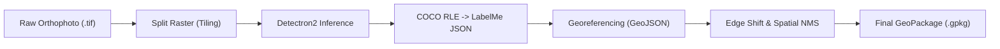

# ITCD Domain-Aware: Inference & Geospatial Pipeline

[](https://www.python.org/downloads/)
[](LICENSE)
[](https://github.com/facebookresearch/detectron2)

A modular Python framework for automated **Individual Tree Crown Delineation (ITCD)** from high-resolution aerial and satellite imagery using Detectron2. The pipeline converts instance segmentation binary masks (COCO RLE) into geospatial polygon layers, performs tile edge-margin filtering, executes **Spatial Non-Maximum Suppression (Spatial NMS)** to eliminate tile-boundary duplicates, and exports production-ready GeoPackage (`.gpkg`) files.

---

## Pipeline Overview



1. **Split Raster (Tiling):** Slices high-resolution orthophotos into fixed-size overlapping GeoTIFF tiles.
2. **Deep Learning Inference:** Runs batch segmentation inference using fine-tuned Detectron2 models to generate COCO RLE masks.
3. **Mask Decoding:** Vectorizes RLE bitmasks into exact LabelMe JSON pixel polygon vertices.
4. **Georeferencing:** Projects pixel coordinates to geographic coordinates using the affine transformation matrix and spatial reference system (CRS) of each tile.
5. **Tile Edge Shift & Spatial NMS:** Removes boundary-truncated crowns along tile edges, resolves inter-tile polygon overlaps using intersection-over-union (IoU), and merges clean polygons into a unified GeoPackage.

---

## Repository Structure

```text
itcd-domain-aware/
├── itcd/                       # Core Python package
│   ├── __init__.py             # Package exports
│   ├── config.py               # ITCDInferenceConfig dataclass
│   ├── tiling.py               # Raster splitting and tiling utilities
│   ├── detector.py             # Detectron2 inference engine
│   ├── converter.py            # RLE bitmask to polygon vectorization
│   ├── georeference.py         # Pixel to GIS coordinate projection
│   ├── spatial_nms.py          # Edge filtering, spatial NMS, and GPKG export
│   └── pipeline.py             # Automated end-to-end pipeline runner
├── notebooks/
│   └── run_inference.ipynb     # Google Colab execution orchestrator
├── models/                     # Model weights directory
│   ├── README.md               # Model download guide (Google Drive)
│   └── 250525_R50_RESTOR_fold_0/
├── sample/                     # Sample datasets directory
│   ├── README.md               # Dataset download guide (Google Drive)
│   └── danum.tif
├── .gitignore
├── LICENSE
├── pyproject.toml              # Build system and package specification
├── README.md                   # Project documentation
└── requirements.txt            # Python dependencies
```

---

## Installation

### 1. Prerequisites
- Python 3.11+
- CUDA-enabled GPU (recommended for inference)
- GDAL / GEOS dependencies (standard on Linux/Colab, or via Conda on Windows)

### 2. Install Dependencies
```bash
git clone https://github.com/ambarwariagus/itcd-domain-aware.git
cd itcd-domain-aware

# Install core dependencies
pip install -r requirements.txt

# Install Detectron2 (Linux/Colab)
python -m pip install 'git+https://github.com/facebookresearch/detectron2.git'

# Install ITCD in editable mode
pip install -e .
```

### 3. Model Weights
Pre-trained Detectron2 model weights (`model_best_AP50.pth`, ~351 MB) are hosted on Google Drive:
- 📥 **[Download Model Weights (Google Drive)](https://drive.google.com/drive/folders/1zdY9J_X9LA5xmOaeynx_SOKfoS9aQCF9?usp=sharing)**
- Place the downloaded `250525_R50_RESTOR_fold_0/` directory into `models/`. See [`models/README.md`](models/README.md) for details.

### 4. Sample Datasets
High-resolution aerial GeoTIFF test rasters (`danum.tif`, etc.) are hosted on Google Drive:
- 📥 **[Download Sample Datasets (Google Drive)](https://drive.google.com/drive/folders/19z289BGBoVkyrhUSGPWl5eASGSdl-P4R?usp=sharing)**
- Place the downloaded GeoTIFF files into `sample/`. See [`sample/README.md`](sample/README.md) for details.

---

## Quick Start

### Python API

Run the end-to-end pipeline in Python:

```python
from itcd import ITCDInferenceConfig, run_full_pipeline

# 1. Initialize configuration
config = ITCDInferenceConfig(
    trained_model_dir="models/250525_R50_RESTOR_fold_0",
    score_thresh_test=0.5,
    nms_thresh_test=0.3,
    tile_size=1024,
    overlap=256,
    edge_shift_meters=1.0,
    spatial_iou_threshold=0.5,
    spatial_conf_threshold=0.5,
    area_threshold_m2=2.0
)

# 2. Execute end-to-end
cleaned_gdf = run_full_pipeline(
    orthophoto_path="sample/cmh01.tif",
    work_dir="sample",
    config=config,
    output_gpkg="sample/tree_crowns.gpkg"
)

print(f"Detected {len(cleaned_gdf)} tree crowns.")
```

### Google Colab

Use the provided notebook [`notebooks/run_inference.ipynb`](notebooks/run_inference.ipynb) for GPU-accelerated execution on Google Colab:
1. Open the notebook in Google Colab and set runtime to **GPU (T4 or higher)**.
2. Mount Google Drive and set paths for the input GeoTIFF and model directory.
3. Run all cells to process the raster and export the final GeoPackage directly to Google Drive.

---

## Configuration Reference

The `ITCDInferenceConfig` class in [`itcd/config.py`](itcd/config.py) provides full control over all pipeline stages:

| Parameter | Type | Default | Description |
|:---|:---:|:---:|:---|
| `trained_model_dir` | `str` | *Required* | Path to folder containing model `config.yaml` and weights |
| `config_file` | `str` | `""` | Optional explicit path to Detectron2 `config.yaml` |
| `model_weights` | `str` | `""` | Optional explicit path to model `.pth` weights |
| `score_thresh_test` | `float` | `0.5` | Minimum confidence score threshold during model inference |
| `nms_thresh_test` | `float` | `0.3` | NMS threshold used during model ROI head evaluation |
| `tile_size` | `int` | `1024` | Tile dimensions in pixels (`1024x1024`) |
| `overlap` | `int` | `256` | Overlap in pixels between adjacent tiles |
| `edge_shift_meters` | `float` | `1.0` | Inward margin (meters) to drop edge-truncated crowns |
| `spatial_iou_threshold`| `float` | `0.5` | Polygon IoU threshold for Spatial NMS deduplication |
| `spatial_conf_threshold` | `float` | `0.5` | Minimum confidence score retained in final layer |
| `area_threshold_m2` | `float` | `2.0` | Minimum crown area in m² to filter noise polygons |
| `polygon_tolerance` | `float` | `0.0` | Polygon contour approximation tolerance |

---

## Step-by-Step Modular API

For advanced workflows, individual pipeline stages can be executed independently:

```python
from itcd import (
    run_tiling,
    ITCDDetector,
    convert_rle_to_labelme,
    batch_labelme_to_geojson,
    stitch_and_clean_pipeline
)

# Step 1: Split orthophoto into tiles
run_tiling("sample/cmh01.tif", "sample/tiles", tile_size=1024, overlap=256)

# Step 2: Detectron2 batch inference
detector = ITCDDetector("models/.../config.yaml", "models/.../model_best_AP50.pth")
detector.predict_directory("sample/tiles", "sample/tiles/predictions")

# Step 3: Decode RLE masks to LabelMe JSON
convert_rle_to_labelme("sample/tiles/predictions", "sample/tiles/labelme_output")

# Step 4: Georeference pixel coordinates to GeoJSON
batch_labelme_to_geojson("sample/tiles/labelme_output", "sample/tiles", "sample/tiles/geojson")

# Step 5: Spatial NMS and GeoPackage export
stitch_and_clean_pipeline(
    geojson_dir="sample/tiles/geojson",
    tif_dir="sample/tiles",
    output_gpkg="output/tree_crowns.gpkg",
    shift=1.0,
    iou_threshold=0.5,
    confidence_threshold=0.5,
    area_threshold=2.0
)
```

---

## Citation

If you use this codebase, methodology, or model in your research, please cite our published paper:

> **A. Ambarwari, E. Husni, R. Darmakusuma, and D. Suwardhi**, "Domain-Aware Transfer Learning With SAM-Assisted Mask R-CNN for Urban Tree Crown Delineation From UAV Orthophotos," in *IEEE Access*, vol. 13, pp. 181286-181301, 2025, doi: [10.1109/ACCESS.2025.3619949](https://doi.org/10.1109/ACCESS.2025.3619949).

```bibtex
@article{ambarwari2025domain,
  author={Ambarwari, Agus and Husni, Emir and Darmakusuma, Reza and Suwardhi, Deni},
  journal={IEEE Access}, 
  title={Domain-Aware Transfer Learning With SAM-Assisted Mask R-CNN for Urban Tree Crown Delineation From UAV Orthophotos}, 
  year={2025},
  volume={13},
  pages={181286--181301},
  doi={10.1109/ACCESS.2025.3619949}
}
```

---

## License

This project is licensed under the MIT License - see the [LICENSE](LICENSE) file for details.

**Author:** Agus Ambarwari ([ambarwariagus@gmail.com](mailto:ambarwariagus@gmail.com))
